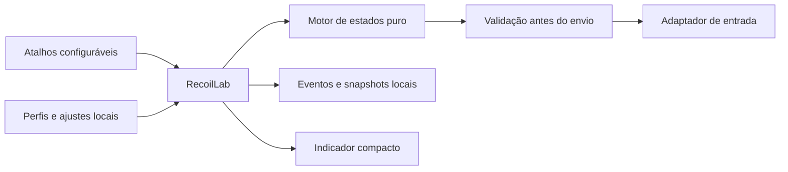

# PUBG Input Lab

Laboratório independente de perfis de movimento em AutoHotkey v2 para Windows. Inclui seleção de arma por atalho, simulação sem enviar movimento, máquina de estados testável e registros locais de execução. A interface mantém o nome **Recoil Lab**.

Os perfis de arma distribuídos são referências **sem calibração de recoil**. Armar um perfil com X/Y iguais a zero não produz compensação. Ajustes pessoais ficam no computador; o projeto não promete spray perfeito, indetectabilidade ou aprovação do PUBG/KRAFTON.

## Biblioteca 1.4.1

O painel inclui uma biblioteca para criar, duplicar, renomear e excluir presets; registrar arma, mira/zoom, postura, acessórios e sensibilidade; editar curvas X/Y com prévia; importar/exportar INI; e editar atalhos sem reiniciar. O ponto central é opcional, desativado por padrão e limitado à janela alvo com foco.

Há também **78 presets SCHOOL (FDCaffeine): 26 armas × 3 posturas**, com licença MIT e origem preservadas. Instalações novas já incluem esses presets. **Ctrl+.** avança e **Ctrl+,** volta entre os presets da mesma arma e modo de disparo, incluindo o ajuste original. A navegação é circular e seleciona/ativa o preset com o jogo em foco; solte o gatilho antes da nova rajada.

Os presets usam a conversão documentada de 16 ms, escala 0,1 e duração de 3 s; continuam não validados. São configurações do laboratório, não alterações nas opções de sensibilidade do PUBG. Seus ajustes pessoais são preservados. Para acrescentar as referências a uma biblioteca existente, feche o aplicativo e execute `Importar-SCHOOL.cmd`; repetições não duplicam nem substituem IDs existentes. Consulte o [guia de presets](docs/PRESETS.md) e os [avisos de terceiros](THIRD_PARTY_NOTICES.md).

## Instalação e validação

Requisitos: Windows x64, PowerShell 5.1 ou superior e acesso HTTPS para baixar o runtime oficial. Na pasta do projeto:

O pacote portátil em [Releases](https://github.com/Victorzinn704/pubg-input-lab/releases) inclui o runtime oficial e sua licença: extraia a pasta e execute `Iniciar.cmd`. Para trabalhar a partir do código-fonte:

```powershell
powershell -NoProfile -ExecutionPolicy Bypass -File .\scripts\Setup-Runtime.ps1
powershell -NoProfile -ExecutionPolicy Bypass -File .\scripts\Prepare-LocalConfig.ps1
powershell -NoProfile -ExecutionPolicy Bypass -File .\Validar.ps1
.\Iniciar.cmd
```

O instalador fixa AutoHotkey 2.0.30 e verifica o SHA-256 publicado pelo projeto oficial. O preparo cria somente arquivos locais ausentes. Uma instalação nova abre em **simulação**, desarmada. A simulação percorre os estados e grava eventos, mas não envia movimento.

## Comandos

Com o jogo em foco, **Ctrl+Alt+letra seleciona e ativa o perfil**. Trocar de arma encerra a rajada anterior e mantém apenas um perfil ativo. Repetir o atalho da mesma arma ligada preserva seu estado e ganho atual. Rearmar a mesma arma depois de ajustar também mantém o ganho aplicado; mudar para outra arma carrega o ganho salvo dela.

| Atalho | Perfil |
| --- | --- |
| Ctrl+Alt+A | M416 |
| Ctrl+Alt+B | Beryl M762 |
| Ctrl+Alt+K | AKM |
| Ctrl+Alt+C | ACE32 |
| Ctrl+Alt+G | Groza |
| Ctrl+Alt+M | AUG |
| Ctrl+Alt+S | SCAR-L |
| Ctrl+Alt+U | UMP |
| Ctrl+Alt+I | Micro UZI |
| Ctrl+Alt+T | Tommy Gun |
| Ctrl+Alt+N | Mini14 |
| Ctrl+Alt+L | Mk12 |
| Ctrl+Alt+J | Mk14, tiro único |
| Ctrl+Alt+O | Mk14, automático |
| Ctrl+Alt+H | SKS |
| **Ctrl+Alt+D** | **Desligar o perfil ativo, mesmo fora do jogo** |

As associações podem ser editadas em **Biblioteca → Atalhos e tela**, com aplicação imediata. São aceitas letras A–Z e números 1–9. D é reservada à parada e Ctrl+Alt+0 alterna o ponto central. Conflitos, perfis desconhecidos e entradas inválidas são rejeitados. Edição externa de `hotkeys.ini`, seção `[Weapons]` (exemplo `M416=A`), exige reiniciar.

F3/F4 ajustam o ganho, F5 salva, F6 abre o painel, F9 marca um evento e F10 executa a sonda de diagnóstico com o botão direito pressionado. F12 encerra o aplicativo. F1/F2/F7/F8/F11 deixam de controlar seleção/ativação. Mouse4 e Mouse5 mantêm suas funções.

Alterar configurações ou abrir o painel desarma o ensaio. Use novamente o atalho da arma depois de ajustar. Após ativar ou trocar o perfil, solte o disparo antes da próxima rajada; o botão de mira pode continuar pressionado. No modo de entrada real, o envio exige foco no alvo e ambos os botões físicos. Perda de foco pausa o envio; a volta exige nova soltura do gatilho. Trocar arma não reinicia o prazo da sessão.

A tarja permanece em uma linha de 280×26 no canto do jogo, sem receber foco ou cliques. Detalhes e mensagens ficam no painel. `SEM AJUSTE` identifica um perfil sem movimento no modo real. A indicação `ARMADO` descreve o estado do programa, não confirma eficácia dentro do jogo.

## Configurações e privacidade

| Arquivo | Finalidade | Versionado |
| --- | --- | --- |
| `profiles.example.ini` | Exemplo de perfis e limites; início em simulação | Sim |
| `hotkeys.example.ini` | Mapeamento inicial dos comandos | Sim |
| `presets.example.ini` | 78 presets atribuídos, gerados da referência fixa | Sim |
| `profiles.ini` | Perfis, alvo e modo locais | Não |
| `hotkeys.ini` | Teclas locais | Não |
| `calibrations.ini` | Ganhos e segmentos salvos pelo usuário | Não |
| `presets.local.ini` | Biblioteca contextual e curvas completas | Não |
| `display.local.ini` | Preferências visuais | Não |
| `*.ini.bak` | Revisão anterior de arquivos editados | Não |
| `references/school/` | 26 referências externas, origem e licença MIT | Sim |
| `logs/`, `tests/artifacts/` | Evidências e arquivos gerados | Não |

Não publique logs brutos: as sessões podem conter nomes de máquina, caminhos e configurações pessoais. O runtime também não é armazenado no Git. O script de preparo não sobrescreve configurações existentes.

## Arquitetura e desenvolvimento

O motor de estados não conhece janelas, teclado ou mouse do Windows. A aplicação traduz os comandos, aplica configurações, registra eventos e faz a última verificação antes do envio. O indicador visual é independente do cálculo de movimento.



Consulte [arquitetura](docs/ARCHITECTURE.md), [auditoria e prioridades](docs/AUDIT-1.3.0.md) e [contribuição](CONTRIBUTING.md). A validação automática usa testes determinísticos e janelas sintéticas, sem enviar entrada ao jogo. Resultado de teste local não equivale a validação de recoil ou aprovação do anticheat.

## Escopo dos ensaios

O PUBG declara macros que reduzem recoil uma violação das regras quando não autorizados. Use simulação para desenvolvimento; ensaios no cliente real dependem de autorização específica e do escopo definido por quem administra o ambiente. Este repositório não comprova vínculo ou autorização da KRAFTON e não implementa ocultação, leitura de memória, injeção no jogo ou evasão do anticheat.

Fontes oficiais: [regras de conduta](https://www.pubg.com/en/clause/rules_of_conduct), [esclarecimento sobre macros de recoil](https://www.pubg.com/en/news/9935), [release do AutoHotkey](https://github.com/AutoHotkey/AutoHotkey/releases/tag/v2.0.30).
